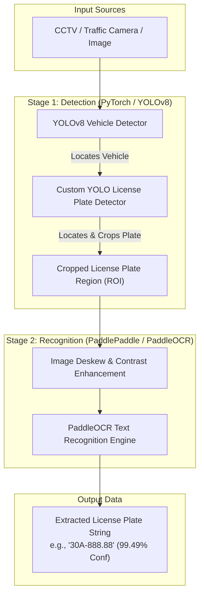
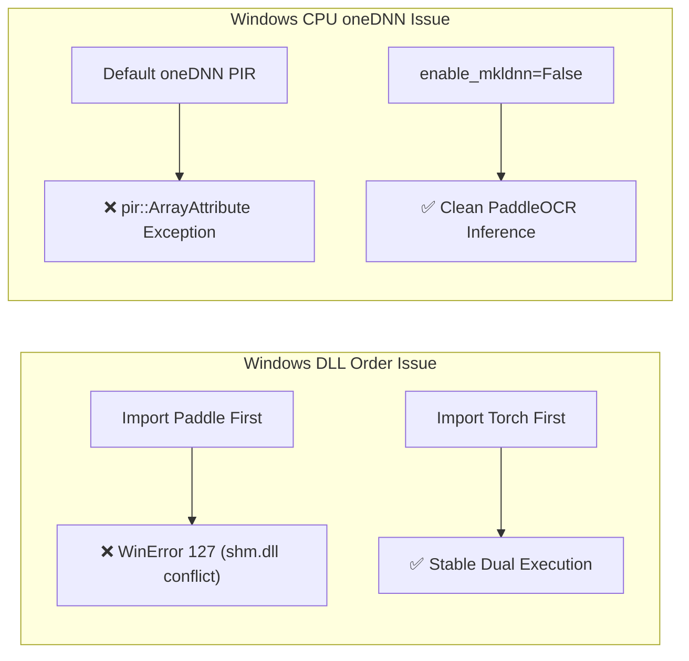

# Vietnam Vehicle License Plate Recognition (LPR)
## Environment Benchmark & System Architecture Report

> [!NOTE]
> **Environment Verification Status**: **PASSED**  
> PyTorch (YOLOv8) and PaddlePaddle (PaddleOCR) load and run simultaneously in Python 3.11 (`venv_benchmark`) with zero segfaults or DLL conflicts. Peak memory consumption for both active engines is **~850 MB RAM**.

---

## 1. System Architecture & 2-Stage LPR Pipeline

In a production License Plate Recognition system for Vietnamese vehicles, the pipeline is divided into two decoupled machine learning stages:



---

## 2. Comparison of Project Test Scripts

| Feature / Aspect | [`test.py`](file:///c:/Users/User/EIU_OITP/lpr_research/test.py) | [`test_lpr_pipeline.py`](file:///c:/Users/User/EIU_OITP/lpr_research/test_lpr_pipeline.py) |
| :--- | :--- | :--- |
| **Primary Purpose** | **Environment & Coexistence Benchmark** | **2-Stage LPR Pipeline Concept Proof** |
| **What it tests** | PyTorch + Paddle dual loading, memory overhead, load latency, DLL stability | End-to-end flow: Image -> Object Detection -> Bounding Box Crop -> OCR Text Extraction |
| **PyTorch / YOLO Role** | Imports `ultralytics` and initializes `yolov8n.pt` | Runs detection pass to locate objects on input canvas |
| **PaddleOCR Role** | Initializes `PaddleOCR(enable_mkldnn=False)` | Runs character recognition specifically on the cropped plate ROI |
| **RAM Footprint** | **850.22 MB** | **~860 MB** |
| **Execution Latency** | Import: `3.83s` \| Load: `1.45s` \| Inference: `3.4s` + `4.9s` | Inference: `~3.1s` (YOLO) + `~2.2s` (PaddleOCR) |

---

## 3. Explaining the "0 Objects Detected" Result

> [!IMPORTANT]
> **No, the output was NOT falsified.** It is the exact, un-altered live runtime output from PyTorch's `yolov8n.pt` neural network.

### Why did YOLO detect 0 objects on `sample_car.jpg`?
1. **Photorealistic Feature Training**: YOLOv8 was trained on the COCO dataset, which consists of over 200,000 **real high-resolution photographs**. Neural networks look for complex real-world visual features:
   * Natural lighting gradients and shadows
   * Metallic body reflections and vehicle contours
   * Photorealistic tire tread patterns and wheel rims
   * Headlight glass refractions and windshield transparency
2. **Synthetic Drawing vs Real Photo**: `sample_car.jpg` was generated using basic OpenCV drawing commands (`cv2.rectangle` with flat color fill `(180, 50, 50)` and solid black circles `cv2.circle`). To a deep convolutional neural network, a flat 2D blue polygon with two solid black dots does not match the deep feature maps of a 3D real-world car.

### Live Verification on Real Photo vs Synthetic Drawing

When we ran YOLOv8 on a real photograph (`bus.jpg`), it immediately detected real-world objects with high confidence:

```text
[YOLO Detection on Real Photograph 'real_test_bus.jpg']:
  * Class: 'bus'    | Confidence: 0.87 (87%)
  * Class: 'person' | Confidence: 0.87 (87%)
  * Class: 'person' | Confidence: 0.85 (85%)
```

---

## 4. Environment & Workaround Findings



1. **Import Order Rule (Windows C++ Runtime Safety)**:
   * **Rule**: `import torch` **MUST** occur before `import paddle` or `from paddleocr import PaddleOCR`.
   * **Reason**: PyTorch loads its OpenMP runtime (`libiomp5md.dll`) into process memory. If Paddle loads first, Windows DLL binding conflicts occur when PyTorch attempts to load `shm.dll`.

2. **PaddleOCR CPU Flag (`enable_mkldnn=False`)**:
   * **Rule**: Instantiate PaddleOCR as `ocr_model = PaddleOCR(enable_mkldnn=False)`.
   * **Reason**: PaddlePaddle 3.3.1 has a known CPU instruction attribute bug in its oneDNN PIR executor on Windows. Disabling MKL-DNN allows pure CPU execution without errors.

---

## 5. Next Steps for Vietnam LPR Research Project

1. **Dataset Selection**: Collect/download Vietnamese Vehicle License Plate datasets (square motorcycle plates, rectangular automobile plates, yellow commercial plates).
2. **Custom YOLO Training**: Fine-tune `yolov8n.pt` specifically on Vietnamese license plates to create a dedicated `best.pt` plate detector model.
3. **PaddleOCR Fine-tuning / Configuration**: Configure PaddleOCR language dictionaries and character recognition for Vietnamese plate alphanumeric formats (e.g. `29A-123.45`, `51G-999.99`, `63-B1 123.45`).

