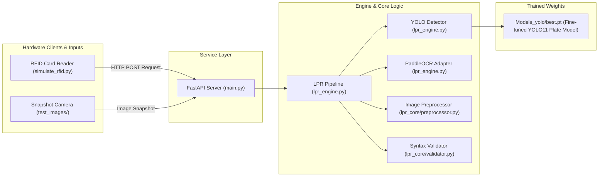

# Automated Vietnamese License Plate Recognition (LPR) & RFID Gate System

An automated license plate detection model (YOLO x PaddleOCR), with RFID card access backend for parking gates. This system automatically locates vehicle license plates, cleans the plate image, transcribes the characters, checks them against official Vietnamese traffic rules, and decides whether to open the security barrier.

Made with: Ultralytics _YOLO11_ for license plate detection, _PaddleOCR_ for character recognition, _OpenCV_ for image preprocessing, and _FastAPI_ for the gate server simulation made for testing latency between RFID to activate the model.


This does not include the test for real-time camera.

---

## 1. System Overview and Data Flow

Added a simulation to showcase when a vehicle pulls up to the gate and a student or employee taps their card:
1. The RFID reader sends an event to the backend server with the card ID and a snapshot image.
2. The system checks if a license plate exists in the image.
3. If found, a bounding box is created which is then cropped, enhanced if needed for shadows and blur, and reads the characters.
4. It checks whether the text matches official Vietnamese license plate syntax (format rules).
5. If both the card and plate match security rules, the barrier gate opens. Otherwise, access is denied. 

### Pipeline Workflow Flowchart

```mermaid
flowchart TD
    A["Vehicle Arrives at Gate"] --> B["RFID Card Tap Trigger"]
    B --> C["FastAPI Server (main.py)<br/>Receives Transaction Event"]
    C --> D["1st try: Fastest Pass (640px)<br/>YOLO11 Plate Detector"]
    
    D -->|Plate Found & Valid Syntax| G["Accept 1st try (Fast Sub-200ms)"]
    D -->|No Plate / Low Conf / Unverified| E["2nd try: Zoom Pass (1024px)<br/>High-Resolution Escalation"]
    
    E -->|Plate Found & Valid Syntax| H["Accept 2nd try (Zoom Verified)"]
    E -->|Plate Found but Minor OCR Noise| I["3rd try: Format Similarity<br/>Checks Vietnamese Template (DDLDDDDD)"]
    E -->|No Plate Found| J["Unreadable Plate"]
    
    G --> K{"Gate Decision Engine"}
    H --> K
    I --> K
    J --> K
    
    K -->|Valid Student Card + Verified Plate (1st/2nd/3rd try)| L["GATE_OPEN<br/>Barrier Opens Normally"]
    K -->|Valid Student Card + Unreadable Plate| M["GATE_OPEN_FLAGGED (CARD_ONLY)<br/>Barrier Opens, Transaction Logged for Guard Audit"]
    K -->|Unauthorized RFID Card| N["ACCESS_DENIED (DENIED)<br/>Barrier Stays Closed, Security Alert Logged"]
```

### Component Dependency Structure



---

## 2. Setting Up the Environment from Scratch

Follow these instructions to set up a clean Python environment on any standard computer or server.

### Prerequisites
* Python 3.10 or 3.11 installed.

### Step 1: Clone the Repository and Navigate to Folder
```bash
git clone <repository_url>
cd lpr_research
```

### Step 2: Create a Virtual Environment (Isolated Workspace)
Create a new virtual environment named `venv`:
```bash
# On Windows, macOS, or Linux:
python -m venv venv
```

### Step 3: Activate the Virtual Environment
```bash
# On Windows (PowerShell):
.\venv\Scripts\Activate.ps1

# On Windows (Command Prompt):
.\venv\Scripts\activate.bat

# On Linux or macOS:
source venv/bin/activate
```

### Step 4: Install Dependencies
Install all required libraries specified in `requirements.txt`:
```bash
pip install --upgrade pip
pip install -r requirements.txt
```

> **Important Note for Windows Users**:  
> In Python scripts where both PyTorch (`torch`) and PaddlePaddle (`paddle` / `paddleocr`) are used, always ensure `import torch` is called **before** importing PaddleOCR to prevent a dynamic library conflict (`libiomp5md.dll`) between the two frameworks on Windows.

---

## 3. File Guide and Architecture Breakdown

### Directory Layout

* `main.py`: The production web server (FastAPI). Receives card tap events and coordinates gate access decisions.
* `lpr_engine.py`: The core engine classes. Connects the detector, preprocessor, OCR, and validation into a unified pipeline.
* `lpr_core/preprocessor.py`: Image enhancement module. Cleans and sharpens cropped plate images before text reading.
* `lpr_core/validator.py`: Traffic rule validator. Checks extracted text against official Vietnamese license plate formats.
* `simulate_rfid.py`: Testing client. Simulates a student tapping an RFID card at the gate.
* `run_benchmark.py`: Batch and single-image testing script. Evaluates performance and dynamically logs results.
* `compare_preprocessing.py`: Diagnostic comparison script. Runs raw vs. enhanced images side by side.
* `BENCHMARK_SUMMARY.md`: Evaluation record. Contains historical test runs and system configuration notes (dynamically created from run_benchmark.py)
* `Models_yolo/`: Folder containing model weight files (`best.pt` for fine-tuned YOLO11 plate model).
* `test_images/`: Folder holding sample vehicle snapshot images for testing.
* `ColabNotebookTemplate/`: Model training notebooks for YOLO on Google Colab.
* `archive/`: Storage folder for legacy scripts and earlier experimental files.

---

## 4. Deep Dive: Core Classes and Functional Modules

### `YOLODetector` in [`lpr_engine.py`]
* **What it does**: Scans the input photo and finds the coordinates (bounding box) of license plates using YOLO11.
* **Key parameters and settings**:
  * `model_weights`: Path to the trained weight file (`Models_yolo/best.pt`).
  * `target_classes`: Restricts detection strictly to `['plate', 'license_plate']`. This prevents the model from accidentally drawing boxes on passersby, umbrellas, or background objects.
  * `confidence_threshold`: Minimum probability floor (set to `0.25`).
  * `imgsz=640` (1st try) / `imgsz=1024` (2nd try zoom escalation): Processes at standard 640px for sub-200ms speed, escalating to 1024px if 1st try is unverified.
* **Expected behavioral impact**: Reliably isolates distant plates without false-positive boxes on non-vehicle objects. Backward compatibility is retained via `YOLOv8Detector = YOLODetector`.

---

### `PaddleOCRAdapter` in [`lpr_engine.py`]
* **What it does**: Reads the alphanumeric characters from the cropped license plate image.
* **Key parameters and settings**:
  * `use_doc_orientation_classify=False`: Disables whole-document rotation detection.
  * `use_doc_unwarping=False`: Disables document dewarping (unwrinkling paper), which is unnecessary for rigid metal plates.
  * `use_textline_orientation=False`: Disables textline tilt checking.
  * `enable_mkldnn=False`: CPU acceleration flag set to false on Windows to prevent runtime executor crashes.
  * `y_center` sorting (vertical coordinate ordering): Calculates the vertical midpoint of each text line detected. Lines higher up on the plate are ordered before lower lines.
* **Expected behavioral impact**: Disabling document-level modules reduces CPU processing latency from several seconds down to an operational range of roughly 1.0 to 2.5 seconds on standard CPUs (and under 50 ms on dedicated edge hardware). Vertical sorting ensures Line 1 (province code) is always placed before Line 2 (serial number) on square plates.

---

### `PlatePreprocessor` in [`lpr_core/preprocessor.py`]
* **What it does**: Enhances the visual quality of the cropped plate image before sending it to OCR.
* **Processing steps**:
  1. **Dynamic bicubic upscaling (resolution boost)**: If a crop is smaller than 160px wide, it is mathematically enlarged by 2.5x to thicken character strokes.
  2. **White border padding**: Adds a 20px white frame around the crop so edge letters are not cut off by text detection boxes.
  3. **Grayscale conversion**: Strips color to focus purely on brightness values.
  4. **CLAHE (adaptive contrast adjuster)**: Equalizes contrast locally so characters hidden in shadows (e.g., under a dark bumper) become visible without overexposing sunny spots.
  5. **Bilateral filter (edge-preserving smoother)**: Removes camera sensor noise and road dirt while keeping the edges of letters sharp.
  6. **Unsharp masking (edge sharpener)**: Uses a high-pass kernel (sharpening filter) to accentuate character borders.
* **Expected behavioral impact**: Recovers missing or faint letters on distant, dusty, or shadowed plates with less than 20 ms of computation time.

---

### `VietnamPlateValidator` in [`lpr_core/validator.py`]
* **What it does**: Cleans up noise symbols and verifies that the text follows official Vietnamese Ministry of Transport formatting rules.
* **Key rules and cleanup logic**:
  * **Automobile pattern (`AUTO_PATTERN`)**: Matches `2 digits + 1 letter + dash + 3 to 5 digits` (e.g., `30E-697.70` or `29M-6840`).
  * **Motorcycle pattern (`MOTO_PATTERN`)**: Matches `2 digits + dash + 1 letter + 1 digit + space + 3 to 5 digits` (e.g., `29-H1 999.99`).
  * **Mounting screw rivet cleaning**: Strips leading and trailing dots or dashes caused by metal bolts and screws holding the plate to the bumper.
  * **Province code numeric correction**: Characters at positions 0 and 1 are always province numbers (11 to 99). If OCR reads an alphabet letter in these first two slots, it corrects it to the closest digit (e.g., letter `O` or `D` becomes `0`, `I` or `L` becomes `1`, `Z` becomes `2`, `B` becomes `8`).
* **Expected behavioral impact**: Corrects common optical misreads automatically and guarantees that invalid strings never trigger the gate barrier.

---

### `LPRPipeline` in [`lpr_engine.py`]
* **What it does**: Coordinates the entire sequence: calls the detector, crops the box with extra margins, runs preprocessing, executes OCR, and applies validation.
* **Key parameters and settings**:
  * **Crop padding margin floor**:
    ```python
    pad_w = max(20, int((x2 - x1) * padding_percent))
    pad_h = max(15, int((y2 - y1) * padding_percent))
    ```
    On plates far from the camera, a flat percentage (like 20%) only adds 6 to 8 pixels of margin, which cuts off letters sitting near the edge. Enforcing a minimum 20px margin guarantees all characters fit inside the crop.
  * **Multi-try resolution escalation**:
    The pipeline runs a multi-try architecture:
    * 1st try: Fastest pass at standard resolution (640px) with natural crop.
    * 2nd try: Escalation to 1024px zoom pass if 1st try had 0 detections or unverified syntax.
    * 3rd try: Format similarity tolerance checking against structural Vietnamese plate templates (`DDLDDDD` / `DDLDDDDD`).
  * **Zero-detection hard guard**: If the detector finds no plates after resolution escalation, the pipeline halts safely rather than attempting full-image OCR.
* **Expected behavioral impact**: Prevents character truncation, achieves sub-200ms latency on clean plates, and eliminates false-positive readings on background clutter.

---

### `main.py` (FastAPI Production Service)
* **What it does**: Provides the REST API endpoint (`/api/v1/rfid-tap`) that physical gate readers connect to.
* **Security gate rules**:
  * If no vehicle or plate is detected: returns `HTTP 422 Unprocessable Entity`.
  * If a 2-line plate is detected: concatenates the top and bottom rows with a hyphen (`-`) and verifies the combined string.
  * Access is granted (`ACCESS_GRANTED`) **only if** `is_valid_format == True` and `confidence >= 0.50`. Otherwise, the gate returns `ACCESS_DENIED`.
* **Expected behavioral impact**: Protects against gate actuation when readings are ambiguous or format validation fails.

---

## 5. Summary of Challenges, Root Causes, and Engineering Fixes

<u>Challenge 1: System crash on Windows startup</u>
* **Cause**: `torch` and `paddle` bundled conflicting versions of an Intel OpenMP library (`libiomp5md.dll`).
* **Fix**: Enforced import precedence where PyTorch is always imported before PaddleOCR.

<u>Challenge 2: High OCR processing latency</u>
* **Cause**: PaddleOCR was loading five separate neural networks by default, including document dewarping (`UVDoc`) and page rotation models meant for wrinkled paperwork.
* **Fix**: Disabled document-level modules in the configuration, reducing OCR latency by over half on standard hardware without any drop in character accuracy.

<u>Challenge 3: Edge characters missing on distant vehicles</u>
* **Cause**: On distant test images, the bounding box was narrow (under 50px). A flat percentage padding produced an 8px margin that sliced through the outer stroke of letters sitting on the right edge.
* **Fix**: Added a minimum margin floor (`max(20, ...)`), which restored the full boundary and enabled complete character recognition.

<u>Challenge 4: Two-line plates failing validation</u>
* **Cause**: Square plates have two lines (e.g., `29M` on top, `8840` on bottom). Validating each line independently failed because neither line is a complete license plate on its own.
* **Fix**: Implemented vertical coordinate sorting (`y_center`), joined the lines with a hyphen (`29M-8840`), and validated the combined plate string.

<u>Challenge 5: False-positive readings on background scenes</u>
* **Cause**: When no plate was detected, an early prototype fell back to scanning the entire photo, occasionally reading roadside advertising text.
* **Fix**: Added a hard zero-detection guard that stops execution and returns an explicit error if no bounding box is found.

---

## 6. Model Training Workflow and Roboflow Dataset

In plain terms, training is the process of teaching the YOLO model what Vietnamese license plates look like by showing it hundreds of labeled vehicle photos.

### Dataset Information
* **Source**: Roboflow Universe (`vietnamese-car-license-plate-vlbzz`).
* **Classes**: `plate` / `license_plate`.
* **Content**: Annotated bounding boxes covering various lighting conditions (daylight, dusk, rain) and angles.

### How to Re-Train on Google Colab (Free GPU)
All training code is prepared in [`ColabNotebookTemplate/train_vietnam_lpr_colab.ipynb`](file:///c:/Users/User/EIU_OITP/lpr_research/ColabNotebookTemplate/train_vietnam_lpr_colab.ipynb) and [`train_vietnam_lpr_colab.py`](file:///c:/Users/User/EIU_OITP/lpr_research/ColabNotebookTemplate/train_vietnam_lpr_colab.py).

1. Open Google Colab and set the runtime to **T4 GPU** (Runtime -> Change runtime type -> T4 GPU).
2. Install dependencies:
   ```bash
   pip install -q ultralytics roboflow
   ```
3. Download the dataset and launch fine-tuning:
   ```python
   from roboflow import Roboflow
   from ultralytics import YOLO

   # Download dataset
   rf = Roboflow(api_key="YOUR_ROBOFLOW_API_KEY")
   project = rf.workspace("alphajack2006-gmail-com").project("vietnamese-car-license-plate-vlbzz")
   dataset = project.version(1).download("yolov8")

   # Train YOLO model (use yolov8n.pt or upgrade to yolo11n.pt)
   model = YOLO("yolov8n.pt")  # or YOLO("yolo11n.pt")
   model.train(
       data=f"{dataset.location}/data.yaml",
       epochs=50,       # 50 complete passes over the dataset
       imgsz=640,       # Training resolution
       batch=16,        # Number of images per training step
       patience=10,     # Stop early if accuracy stops improving for 10 epochs
       name="vietnam_plate_lpr"
   )
   ```
4. Download the resulting weights file (`runs/detect/vietnam_plate_lpr/weights/best.pt`) and place it into [`Models_yolo/best.pt`](file:///c:/Users/User/EIU_OITP/lpr_research/Models_yolo/best.pt) on your local machine. If fine-tuning YOLO11, name the export `yolo11n_plate.pt` or `best.pt`.

---

## 7. Edge Server Integration and Production Deployment

In a commercial parking facility, there are two common ways to connect this backend to physical barrier hardware:

### Approach A: Event-Driven Trigger (Default Setup)
* **How it operates**: The camera remains idle until a vehicle rolls over an induction loop wire in the pavement or the driver taps an RFID card. The gate controller sends a single snapshot to `POST /api/v1/rfid-tap`.
* **Hardware impact**: Zero CPU utilization while idle. Processing occurs only during the brief transaction window.
* **Best suited for**: Campuses and standard parking facilities where cars come to a full stop at the gate.

### Approach B: Asynchronous Lookahead Buffer (High-Speed Traffic)
* **How it operates**: A background worker continuously reads a live camera feed (at 5 to 10 FPS) covering the lane. As a vehicle rolls up, its plate is detected, validated, and cached in a temporary memory store (e.g., `recent_plates["29M-8840"] = timestamp`).
* **Hardware impact**: Continuous baseline CPU usage, but when the driver taps the card, the API performs an instant in-memory lookup.
* **Expected operational range**: Reduces driver wait time to near-instantaneous response (typically under 50 ms perceived gate reaction time).

### Hardware Acceleration Recommendations
To transition from a laptop CPU to field edge servers:
* **NVIDIA Jetson (Orin Nano / AGX)**: Convert model checkpoints to **TensorRT (FP16)** for hardware-accelerated tensor execution.
* **Intel Edge Mini-PCs (Core i5 / N100)**: Run models using **OpenVINO INT8** quantization (compressing model precision from 32-bit to 8-bit integers) to achieve sub-100ms inference on standard CPUs.

---

## 8. Running the System and Executing Tests

Make sure your virtual environment is active before running any commands.

### 1. Launch the Production FastAPI Service
```bash
python main.py
```
* Interactive Swagger API documentation will be available at: `http://127.0.0.1:8000/docs`

### 2. Simulate an RFID Card Tap Event
In a separate terminal, trigger a simulated gate tap with an image from the test folder:
```bash
python simulate_rfid.py test_images/car_test_3.jpg
```

### 3. Evaluate Single Images or Whole Directories
Run the benchmark script on an individual image:
```bash
python run_benchmark.py test_images/car_test_3.jpg
```

Or run the benchmark on all images in a directory at once:
```bash
python run_benchmark.py test_images
```
*Every run automatically records the tested filename, extracted plate, confidence, and format validity to [`BENCHMARK_SUMMARY.md`](file:///c:/Users/User/EIU_OITP/lpr_research/BENCHMARK_SUMMARY.md).*

### 4. Run Preprocessing Comparison (Raw vs. Enhanced)
To inspect what CLAHE and bilateral filtering do to an image:
```bash
python compare_preprocessing.py test_images/car_test_3.jpg
```
*Outputs side-by-side diagnostic image crops to `Outputs/ablation_raw_car_test_3.jpg` and `Outputs/ablation_enhanced_car_test_3.jpg`.*
