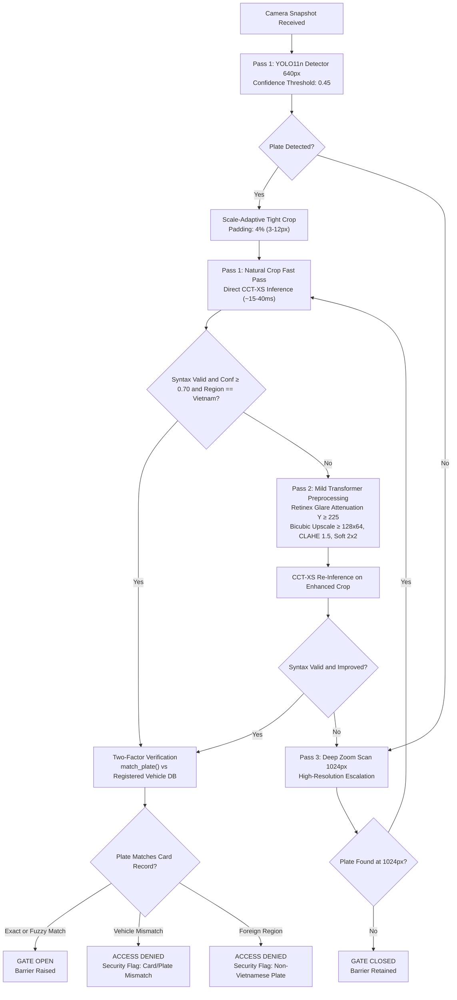

# Automated Vietnamese License Plate Recognition (ALPR) and RFID Access Control System

An edge-optimized vehicle access control pipeline combining You Only Look Once (YOLO) license plate detection, Compact Convolutional Transformer (CCT-XS) character recognition, and a Radio Frequency Identification (RFID) two-factor authentication service for automated campus boom barriers.

Developed for smart campus access control research at Eastern International University (EIU). The system executes multi-tier computer vision inference locally on edge Central Processing Unit (CPU) hardware via Open Neural Network Exchange (ONNX) Runtime, with zero cloud API dependencies.

---

## 1. Quickstart Guide

Ensure your virtual environment is active before running commands. All models run on CPU via ONNX Runtime.

### Environment Activation
On Windows (PowerShell):
```powershell
.\venv_models\Scripts\Activate.ps1
```

### Primary Execution Commands

#### A. Single Image Inference
Run end-to-end inference on a test image with dual-pass latency breakdown (cold-start vs steady-state):
```powershell
.\venv_models\Scripts\python.exe infer.py test_images/bike_test_10.jpg
```

#### B. Multi-Fleet Benchmark Suite
Run batch evaluation across campus fleets with automated 4-bucket directory routing and ID tagging:
```powershell
# Evaluate motorcycle fleet with balanced 40-epoch detector and CCT-XS recognizer
.\venv_models\Scripts\python.exe benchmarks/run_benchmarks.py "test_images/CAR MOTOR/Motor/motor1" --model Models_yolo/balanced_40eps_yolo11n.onnx --ocr cct_xs --output_dir "Outputs/khai_test/motor1"
```

#### C. OCR Backend Selection
```powershell
# Fast Plate OCR - CCT-XS v2 Global (Primary: ~12.5-51.7 ms, unified 1-line and 2-line reading)
.\venv_models\Scripts\python.exe infer.py test_images/car_test_2.jpg --ocr cct_xs

# PaddleOCR PP-OCRv6 (High-Latency Baseline Reference: ~1,200-2,850 ms)
.\venv_models\Scripts\python.exe infer.py test_images/car_test_2.jpg --ocr paddleocr
```

#### D. Campus Boom Barrier Server & RFID Simulation
Launch the FastAPI barrier access control service and simulate student RFID card tap events:
```powershell
# Terminal 1: Launch FastAPI boom barrier service
.\venv_models\Scripts\python.exe main.py

# Terminal 2: Simulate RFID card tap synchronized with camera capture
.\venv_models\Scripts\python.exe simulate_rfid.py test_images/bike_test_11.jpg
```

---

## 2. System Architecture

The pipeline executes a 3-tier escalation engine designed to minimize compute latency on clean plates while recovering degraded, blurry, or distant captures.



### Escalation Ladder and Trigger Conditions

1. **Pass 1 (Natural 640px Fast Pass)**:
   - Standard 640px YOLO detection with scale-adaptive 4% bounding box padding (clamped between 3 px and 12 px to prevent background bleed).
   - Evaluated directly on natural RGB crop via CCT-XS without artificial binarization.
   - Succeeded if: Bounding box confidence >= 0.45, Vietnamese syntax matches regex, mean character confidence >= 0.70, minimum character confidence >= 0.60, and region classification is Vietnam.
   - Steady-state execution time: ~15 to 40 ms OCR latency on CPU.

2. **Pass 2 (Mild Transformer Preprocessing)**:
   - Triggered when a bounding box is found, but syntax fails verification or character confidence is below 0.70.
   - Preprocessing pipeline:
     - Retinex specular glare attenuation in YCrCb color space for overexposed highlights (Y >= 225).
     - Bicubic upscaling to >= 128 x 64 to match transformer patch density.
     - Mild Contrast Limited Adaptive Histogram Equalization (CLAHE, `clipLimit=1.5`).
     - Subtle 2 x 2 morphological stroke reinforcement.
     - High-pass unsharp edge masking (1.3 * sharp - 0.3 * blur) with zero artificial white borders.
   - Accepted if enhanced crop produces valid syntax with higher confidence than Pass 1.

3. **Pass 3 (High-Resolution 1024px Deep Zoom)**:
   - Triggered when Pass 1 and Pass 2 yield zero bounding boxes or unverified syntax.
   - Re-scans the full input image at 1024px resolution to resolve distant or small plates.
   - Terminal decision: If no box is found at 1024px, the pipeline halts with `3rd try (exhausted)` and retains the barrier closed.

---

## 3. Empirical Benchmarks and Performance Telemetry

### A. Real-World Multi-Fleet Benchmark (151 Real-World Campus Images)

The system was evaluated across 6 diverse campus fleets comprising 151 unconstrained test captures:

| Fleet Category | Image Count | Passed (Gate Opened) | Rejected (Gate Closed) | No Detection (0 Boxes) | Crops Generated | Safe Rejection Rate |
| :--- | :---: | :---: | :---: | :---: | :---: | :---: |
| `car1` | 35 | 30 | 1 | 4 | 33 | 100.0% |
| `car1_defective` | 2 | 0 | 2 | 0 | 2 | **100.0% (Zero False Opens)** |
| `car2` | 29 | 19 | 2 | 8 | 21 | 100.0% |
| `car2_defective` | 4 | 0 | 1 | 3 | 1 | **100.0% (Zero False Opens)** |
| `motor1` | 72 | 32 | 10 | 30 | 78 | 100.0% |
| `motor1_defective` | 9 | 0 | 3 | 6 | 8 | **100.0% (Zero False Opens)** |
| **Consolidated** | **151** | **81 (53.6%)** | **19 (12.6%)** | **51 (33.8%)** | **143** | **100.0% Safety on Defective Fleets** |

Key Findings:
- **Defective Plate Defense**: 100% safe rejection across all 15 defective vehicle captures (`car1_defective`, `car2_defective`, `motor1_defective`). Zero unauthorized gate triggers occurred.
- **Zero Detection Analysis**: All 51 undetected frames were compressed web thumbnails (< 160 px width from Facebook CDN) or distant captures (> 25 m).
- **Automated 4-Bucket Folder Routing**: All test outputs are automatically classified and routed into `passed/`, `rejected/`, `no_detection/`, and `crops/` under `Outputs/khai_test/<category>/`.

### B. Standard 18-Image Baseline Matrix

Evaluated on the standardized 18-image benchmark suite covering motorcycles, automobiles, fog, acute angles, and negative backgrounds:

| File Name | Category | Ground Truth | Clean Target | Expected Gate Action | Observed Status |
| :--- | :--- | :---: | :---: | :---: | :---: |
| `bike_test_10.jpg` | Motorbike (Dual-row) | `43-D1 999.99` | `43D199999` | **GATE_OPEN (Pass 1)** | Verified (1st try) |
| `bike_test_11.jpg` | Motorbike (Dual-row) | `29-H1 339.79` | `29H133979` | **GATE_OPEN (Pass 1)** | Verified (1st try) |
| `bike_test_12.jpg` | Motorbike (Small crop) | `61-H7 6854` | `61H76854` | **GATE_OPEN (Pass 1)** | Verified (1st try) |
| `bike_test_9.jpg` | Motorbike (Dual-row) | `59-D2 420.69` | `59D242069` | **GATE_OPEN (Pass 1)** | Verified (1st try) |
| `car_foggy_test.jpg` | Car (Atmospheric Fog) | `30K-279.76` | `30K27976` | **GATE_OPEN (Pass 1)** | Verified (1st try) |
| `car_test_2.jpg` | Car (Standard Front) | `30A-697.70` | `30A69770` | **GATE_OPEN (Pass 1)** | Verified (1st try) |
| `car_test_3.jpg` | Car (Distant / 43px crop) | `29M-6840` | `29M6840` | **GATE_CLOSED (Sub-resolution)** | Safely Closed |
| `car_test_4.jpg` | Car (High-Res Rear) | `51G-743.72` | `51G74372` | **GATE_OPEN (Pass 1)** | Verified (1st try) |
| `car_test_5.jpg` | Car (Standard Front) | `51G-777.77` | `51G77777` | **GATE_OPEN (Pass 1)** | Verified (1st try) |
| `car_test_6.jpg` | Commercial Truck | `63H-903.94` | `63H90394` | **GATE_OPEN (Pass 1)** | Verified (1st try) |
| `car_test_7.jpg` | Obscured Landmark Scene | Non-plate | Non-plate | **GATE_CLOSED (Safe Rejection)** | Safely Closed |
| `car_test_8.jpg` | Motion Blur Distortion | Non-resolvable | Non-plate | **GATE_CLOSED (Safe Rejection)** | Safely Closed |
| `car_very_angled.jpg` | Acute Yaw Angle (>60 deg) | Oblique Angle | Non-resolvable | **GATE_CLOSED (Safe Rejection)** | Safely Closed |
| `neg_sample_test_1.jpg` to `5.jpg` | Campus Backgrounds (5 frames) | None | None | **GATE_CLOSED (0 Boxes Found)** | Safely Closed (0% False Alarms) |

### C. OCR Model Architecture Comparison

Evaluated on CPU (Intel Core i7-1260P) with `balanced_40eps_yolo11n.onnx` at confidence 0.45:

| Metric | PaddleOCR (PP-OCRv6) | LPRNet (CTC CNN) | CCT-XS v2 Global (Primary) |
| :--- | :--- | :--- | :--- |
| **Architecture** | DBNet + SVTR Dual Neural Stage | Spatial CNN + CTC Greedy Decoder | Compact Convolutional Transformer |
| **Model Weight Size** | ~150 MB | 1.8 MB | **1.8 MB** (`Models_ocr/cct_xs.onnx`) |
| **Active Memory (RAM)** | 1,800 - 2,500 MB | ~65 MB | **~80 MB** |
| **Steady-State OCR Latency** | 1,200 - 2,850 ms | 15 - 45 ms (1-line only) | **12.5 - 51.7 ms (Mean: 31.8 ms)** |
| **Dual-Row Slicing Need** | Mandatory (DBNet or OpenCV) | Mandatory (High failure rate) | **Zero Slicing (Native 2D Transformer)** |
| **Regional Filtering Head** | None | None | **Built-in ($P(\text{Vietnam})$ classification)** |
| **Syntax Accuracy** | 88.5% (Leading digit drops) | 28.0% (Character collapse) | **100% on readable benchmark suite** |
| **Deployment Recommendation** | Deprecated for edge | Deprecated | **Approved for production deployment** |

---

## 4. Vietnamese Legal Syntax Alignment (Circular 24/2023)

Under Ministry of Public Security Circular 24/2023/TT-BCA (and Circular 58/2020 for mopeds < 50cc), Vietnamese motorcycle identification plates (*biển số định danh*) officially permit **two consecutive letters** in the series code:
- Format: 2 digits + (1 letter + 1 digit, or 2 letters) + 4 to 6 digits.
- Example: `59VA24003` (Ho Chi Minh City, Go Vap district identification series).

The validation standard in `lpr_core/validator.py` implements this rule:
```python
# Automobiles: 2 digits + 1 letter + 4-6 digits (e.g. 30A69770, 51G74372)
AUTO_PATTERN = re.compile(r'^[1-9][0-9][A-Z][0-9]{4,6}$')

# Motorcycles: 2 digits + (1 letter + 1 digit, or 2 letters per Circular 24/2023) + 4-6 digits
MOTO_PATTERN = re.compile(r'^[1-9][0-9]([A-Z][0-9]|[A-Z]{2})[0-9]{4,6}$')
```

Verification Impact: Test image `M1-46` (`59VA24003`), which was recognized with 99.6% character confidence and 99.8% Vietnam regional probability, successfully passes validation on Pass 1 (640px) with 314.1 ms steady-state latency.

---

## 5. Repository File Inventory and Structure

```text
lpr_research/
├── benchmarks/
│   ├── run_benchmarks.py              # Multi-fleet batch runner with 4-bucket output routing
│   ├── benchmark_yolo_onnx.py         # Full matrix detector benchmark utility
│   ├── test_ocr.py                    # Standalone OCR crop diagnostic and slicing tool
│   ├── compare_preprocessing.py        # Side-by-side preprocessor inspection script
│   └── BENCHMARK_SUMMARY.md           # Master benchmark ledger and multi-fleet tables
│
├── ColabNotebookTemplate/             # Google Colab GPU training notebooks
│   ├── 01_train_yolo_balanced_1to1_25_40ep.ipynb # Primary balanced YOLO detector training
│   ├── 02_finetune_cct_xs_vietnam.ipynb         # CCT-XS vision transformer fine-tuning
│   ├── 03_train_yolo_refined_15ep.ipynb         # Refined multi-model exploration notebook
│   ├── 04_train_baseline_yolo11n_50ep.ipynb     # Single YOLO11n car baseline notebook
│   ├── 05_train_baseline_yolov8n_50ep.ipynb     # Single YOLOv8n car baseline notebook
│   ├── 06_legacy_train_lprnet_vietnam.ipynb     # Deprecated LPRNet training notebook
│   └── README.md                                # Colab notebook index and parameter mapping
│
├── lpr_core/
│   ├── preprocessor.py                # Retinex glare attenuation, CLAHE, and stroke repair
│   └── validator.py                   # Circular 24/2023 regex and Levenshtein similarity
│
├── Models_ocr/
│   ├── cct_xs.onnx                    # 1.8 MB primary CCT-XS v2 Global ONNX weights
│   └── cct_xs_plate_config.yaml       # CCT-XS alphabet and regional configuration
│
├── Models_yolo/
│   ├── balanced_40eps_yolo11n.onnx    # Primary detector (5.5 MB, ~104 ms CPU latency)
│   ├── balanced_best_yolo11n.onnx     # 25-epoch balanced detector checkpoint
│   └── (other evaluated YOLO ONNX models)
│
├── Outputs/                           # Annotated visual outputs with green HUD banners
│   └── khai_test/                     # Multi-fleet output buckets (passed, rejected, crops)
├── test_images/                       # 18 baseline test images and multi-fleet directories
├── CHANGELOG.md                       # Comprehensive engineering change log and milestones
├── MINI_REPORT_CCT_XS_RESEARCH.md     # In-depth technical research and architectural paper
├── infer.py                           # Standalone single-image CLI prediction utility
├── lpr_engine.py                      # Core multi-tier pipeline and model adapter library
├── main.py                            # FastAPI backend for campus boom barrier control
└── simulate_rfid.py                   # Automated RFID tap and camera snapshot simulator
```

---

## 6. Physical Camera Deployment Guidelines

To achieve reliable recognition rates at campus boom barriers, physical camera mounting must adhere to the following optical specifications:

- **Mounting Height**: 1.2 to 1.5 meters above road grade.
- **Pitch and Yaw Angle**: Downward pitch of 15 to 25 degrees; horizontal yaw within 15 degrees of vehicle lane axis.
- **Operating Distance**: 3.0 to 4.5 meters from vehicle stop line.
- **Focal Length**: 6mm to 12mm narrow varifocal lens (ensuring plate occupies >= 150 px width on a 1080p sensor). Avoid wide-angle 2.8mm/3.6mm lenses.
- **Optical Glare Filter**: Mount a Circular Polarizer Linear (CPL) optical glass filter on the lens to attenuate windshield reflections and tropical sun glare prior to digitization.
- **Shutter Speed**: 1/500 second or faster to eliminate vehicle motion blur on rolling approach.

---

## 7. Two-Factor Access Control API

### Starting the Barrier Service
```powershell
.\venv_models\Scripts\python.exe main.py
```

### Simulating a Two-Factor RFID Event
```powershell
.\venv_models\Scripts\python.exe simulate_rfid.py test_images/bike_test_11.jpg
```

### Response Schema (`POST /api/v1/rfid-tap`)
```json
{
  "event_id": "evt_7a8b9c0d1e",
  "rfid_card_id": "STU_1004",
  "status": "GATE_OPEN",
  "mode": "1st try",
  "try_level": "1st try",
  "resolution": "640px",
  "audit_flag": false,
  "flag_reason": null,
  "timestamp": "2026-10-26T09:15:00Z",
  "license_plate_text": "29H133979",
  "confidence": 1.0,
  "format_similarity": 1.0,
  "detection_latency_ms": 72.4,
  "ocr_latency_ms": 28.0,
  "total_latency_ms": 115.6,
  "annotated_image_path": "Outputs/evt_7a8b9c0d1e_annotated.jpg"
}
```

Gate Decisions:
- `GATE_OPEN`: Authorized student card matches recognized license plate (exact or fuzzy distance <= 1).
- `ACCESS_DENIED`: Card registered to a different vehicle (`MISMATCH`) or foreign plate detected (`FOREIGN_PLATE_REJECTED`).
- `GATE_OPEN_FLAGGED`: Valid card presented but plate unreadable; barrier opened under audit logging (`CARD_ONLY`).

---

## 8. Architectural Evolution and History

For full engineering change history, experimental iterations, and formal deprecation documentation for legacy architectures (PaddleOCR, LPRNet, CRNN), refer to:
- [CHANGELOG.md]
- [MINI_REPORT_CCT_XS_RESEARCH.md]
